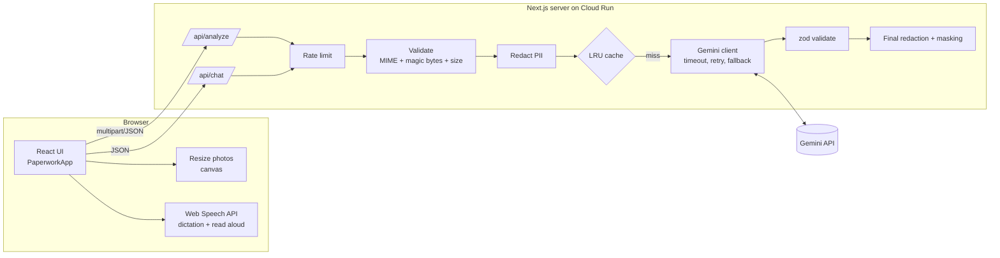

# Paperwork Pal

Upload or paste a confusing official letter (government notice, bank or insurance letter, tax notice, rental agreement, scheme form) and get a **plain-language explanation, a short action checklist and the deadline, in your own language, with voice support**.

Built for people who struggle with jargon-heavy paperwork because of language, literacy or disability: citizens with limited English, elderly users, people with low vision, and anyone overwhelmed by formal documents.

> Paperwork Pal explains documents. It does **not** give legal, tax or financial advice, and it always says so.

|                |                                                                                 |
| -------------- | ------------------------------------------------------------------------------- |
| **Live demo**  | `https://YOUR-SERVICE-URL` (add after deploying, see [Deployment](#deployment)) |
| **Screenshot** | _Add `docs/screenshot.png` after deploying_                                     |
| **Hackathon**  | Promptwars x AI Vibeathon 2026                                                  |

## Features

- **Input:** photo or PDF (JPG, PNG, WEBP, PDF) or pasted text. Text can be dictated with the microphone.
- **AI analysis (Gemini):** document type, plain summary, who sent it and what they want, key facts (reference numbers masked), **deadline**, **3 to 7 step checklist**, **risk level** (icon + text) and questions to ask the sender.
- **8 output languages:** English, Hindi, Tamil, Telugu, Kannada, Malayalam, Bengali, Marathi.
- **Read aloud** (pause, resume, stop) using the browser's speech synthesis, with a voice matched to the language.
- **Follow-up chat** that answers from this document only, and says "I can't tell from this document" otherwise.
- **Deadline helpers:** "Add to Google Calendar" link and `.ics` download. No sign-in needed.
- **Accessibility controls:** text size (A-, A, A+), high contrast, full keyboard use, screen-reader announcements.
- **3 built-in sample documents** (all fake) so anyone can try it with one click and no upload.
- **Privacy first:** personal numbers are hidden before text reaches the AI, nothing is stored.

## How this meets the evaluation criteria

### Code Quality

- Clear structure: UI in `src/components`, all logic in `src/lib` (no business logic inside components), state in small hooks under `src/hooks`, thin API routes under `src/app/api`.
- TypeScript `strict` (plus `noUncheckedIndexedAccess`), no `any` (enforced by ESLint), named exports with explicit types, JSDoc on non-trivial functions.
- One place for limits and tunables: `src/lib/constants.ts`. Languages in `src/lib/languages.ts`. Server settings from env in `src/lib/config.ts`.
- One small error type (`AppError` in `src/lib/errors.ts`) turns every failure into `{ "error": { "code", "message" } }` with the right status.
- One source of truth for AI output: the zod schema in `src/lib/gemini/schema.ts` validates the model's answer **and** generates the JSON schema sent to Gemini.
- ESLint (`eslint-config-next`), Prettier, and a CI workflow (`.github/workflows/ci.yml`) that runs everything on each push.

### Security

| Concern                  | What we do                                                                                                                                                                                                                                      | Where                                                    |
| ------------------------ | ----------------------------------------------------------------------------------------------------------------------------------------------------------------------------------------------------------------------------------------------- | -------------------------------------------------------- |
| Secrets                  | `GEMINI_API_KEY` is read on the server only. `.env*` is git-ignored (except `.env.example`). The built client assets are free of the key and of any Gemini URL.                                                                                 | `src/lib/config.ts`, `.gitignore`                        |
| PII redaction            | Aadhaar, PAN, Indian mobile, email, bank account, card (Luhn-checked) and IFSC are replaced with tags like `[PAN]` **before** anything is sent to Gemini. Chat questions are redacted too. Dates and amounts are not touched (tested).          | `src/lib/security/redact.ts`                             |
| Output PII               | The model's answer is redacted again, and long reference numbers are masked (`•••••5678`), which matters for photos and PDFs that cannot be redacted before upload.                                                                             | `src/lib/gemini/analyze.ts` (`finalizeAnalysis`)         |
| Upload validation        | Declared MIME type **and** magic bytes must match; size limit (413) and type (415) are enforced; body size is checked from `Content-Length` before reading.                                                                                     | `src/lib/security/validate.ts`                           |
| Prompt injection         | Document text is fenced in `<document>` tags and any fake closing tag inside it is neutralised. The system prompt calls the document untrusted data. Output is schema-constrained, then zod-validated, then redacted. Injection tests exist.    | `src/lib/gemini/prompts.ts`, `tests/api.analyze.test.ts` |
| Safe output              | All AI text is rendered as plain React text (no `dangerouslySetInnerHTML`). Calendar link parts go through `encodeURIComponent`; `.ics` text is escaped.                                                                                        | `src/lib/calendar.ts`, tests                             |
| Abuse resistance         | Per-IP, per-route rate limit (`RATE_LIMIT_PER_MIN`, with `Retry-After`), input length caps (20,000 characters, 500-character questions, 10 history items), size limits. The in-memory limiter is best-effort on serverless (noted in the code). | `src/lib/security/rateLimit.ts`, `src/lib/api/http.ts`   |
| Headers                  | Content-Security-Policy, `X-Content-Type-Options: nosniff`, `Referrer-Policy: strict-origin-when-cross-origin`, `X-Frame-Options: DENY`, HSTS, and a restrictive `Permissions-Policy` that allows the microphone for this origin only.          | `src/lib/securityHeaders.ts`, `next.config.ts`           |
| No persistence / logging | Nothing is stored. Logs contain only request id, route, status and timing, never document text. Errors never leak stack traces or raw model messages.                                                                                           | `src/lib/api/http.ts`                                    |
| Dependencies             | Few, pinned to exact versions, `npm audit` reports 0 vulnerabilities.                                                                                                                                                                           | `package.json`                                           |

### Efficiency

- **Cache:** identical requests (hash of _redacted_ content + language) are served from an in-memory LRU (50 entries, 30-minute TTL), so a repeat costs no Gemini call. The cache never holds raw PII. `src/lib/cache.ts`
- **Fast, cheap model:** a Flash-Lite model by default, with a fallback model. Both set by env var.
- **Small payloads:** photos are resized in the browser to at most 1600 px and re-encoded as JPEG (quality 0.8) before upload. `src/lib/client/files.ts`
- **No duplicate calls:** the submit button is disabled while loading, a new request aborts the one in flight, and Cancel aborts it.
- **Lean client:** the result screen is lazy-loaded; fonts come from `next/font` (self-hosted, per-script so only the scripts on screen download); no UI library, no zod on the client.
- Lighthouse on a local production build (mobile defaults): Performance 100, Accessibility 100, Best Practices 96 before the favicon was added (the only failure was a missing `favicon.ico`).

### Testing

Run everything with one command: `npm test` (237 tests, about 15 seconds). `npm run test:coverage` reports about 96% line coverage of `src/lib`.

| Area                | Tests                                                                                                                                                                              |
| ------------------- | ---------------------------------------------------------------------------------------------------------------------------------------------------------------------------------- |
| Unit                | `tests/redact.test.ts` (every pattern, false positives, Luhn), `validate`, `schema`, `calendar`, `cache`, `rateLimit`, `config`, `speech`, client helpers                          |
| Gemini layer        | `tests/gemini.client.test.ts` (backoff, 429/503 retry, fallback model, auth errors, no logging of content), `gemini.prompts`, `gemini.analyze`                                     |
| API (Gemini mocked) | `tests/api.analyze.test.ts`, `api.chat.test.ts`: success, validation (400/413/415), cache hit, rate limit (429), malformed AI output, **prompt injection**, no-PII-in-logs         |
| Resilience          | `tests/api.resilience.test.ts` drives the real client with a mocked SDK: **429 retries, then falls back, then a friendly 503**                                                     |
| Components and a11y | `tests/a11y.test.tsx` runs **jest-axe** on every main component and state, and checks labels, roles, keyboard use, focus, `lang`; `tests/flow.test.tsx` covers the whole user flow |
| Security headers    | `tests/securityHeaders.test.ts`                                                                                                                                                    |

### Accessibility

- **WCAG 2.2 AA** targets: one `h1`, logical heading order, landmarks (`header`, `nav`, `main`, `footer`, labelled `section`s), a skip link, a visible 3 px focus ring, every field has a `label`, and nothing traps the keyboard.
- **Announcements:** an `aria-live="polite"` region says "Analyzing your document…", "Result ready…" or the error text. Focus moves to the result heading when the analysis finishes. After a follow-up answer, focus returns to the question box.
- **Not colour alone:** risk is shown as a distinct icon shape plus words ("High risk"). Colour pairs are at least 4.5:1, and there is a **high-contrast mode** (`src/app/globals.css`).
- **Text size** A-, A, A+ and high contrast are remembered in `localStorage` (wrapped in try/catch). `prefers-reduced-motion` and `prefers-color-scheme` are respected.
- **Touch targets** are at least 44 px; the layout was checked at 320 px wide with the largest text (no horizontal scroll).
- **Voice:** read aloud with pause/resume/stop and a language-matched voice (`src/hooks/useReadAloud.ts`, `src/lib/speech.ts`), and dictation with the microphone. Both detect support and show a plain message when unavailable or when the device has no voice for the language.
- The result container carries `lang` for the output language so screen readers pronounce it correctly; English interface labels inside it are marked `lang="en"`.
- Plain-language copy for every label and error. Automated: `jest-axe` tests plus Lighthouse Accessibility 100.

### Google Services

| Service                               | How we use it                                                                                                                                            | Cost                              |
| ------------------------------------- | -------------------------------------------------------------------------------------------------------------------------------------------------------- | --------------------------------- |
| **Gemini API** (`@google/genai`)      | Document understanding (text and photos/PDFs), explanation, translation to 8 languages, follow-up chat. Structured JSON output via `responseJsonSchema`. | Free tier, rate limited           |
| **Google Cloud Run**                  | Hosts the container (`Dockerfile`, Next.js `standalone` output)                                                                                          | Free tier, billing account needed |
| **Google Secret Manager** (optional)  | Stores `GEMINI_API_KEY` for Cloud Run                                                                                                                    | Small free allowance              |
| **Google Calendar**                   | Template link `https://calendar.google.com/calendar/render?action=TEMPLATE&…` plus an `.ics` fallback (no OAuth)                                         | Free                              |
| **Google Fonts** (`next/font/google`) | Noto Sans plus Devanagari, Tamil, Telugu, Kannada, Malayalam and Bengali, self-hosted at build time                                                      | Free                              |
| **Firebase Hosting** (optional)       | Possible alternative or extra front end hosting. Not used.                                                                                               | Free on Spark                     |

## Architecture



Request flow for `/api/analyze`: rate limit → body size check → parse → zod fields → file validation → text redaction → cache lookup → Gemini (structured output) → zod validation (one re-ask on failure) → output redaction → zod-validated response.

## Setup

Prerequisites: Node.js 20.9 or newer, and a Gemini API key from [Google AI Studio](https://aistudio.google.com/apikey).

```bash
npm install
cp .env.example .env.local      # then put your key in GEMINI_API_KEY
npm run dev                     # http://localhost:3000
npm test                        # run all tests
```

| Variable                | Default                 | Purpose                               |
| ----------------------- | ----------------------- | ------------------------------------- |
| `GEMINI_API_KEY`        | (required)              | Server-side only                      |
| `GEMINI_MODEL`          | `gemini-3.5-flash-lite` | Primary model                         |
| `GEMINI_FALLBACK_MODEL` | `gemini-3.1-flash-lite` | Used after the primary keeps failing  |
| `MAX_UPLOAD_MB`         | `5`                     | Largest upload                        |
| `RATE_LIMIT_PER_MIN`    | `10`                    | Requests per IP per minute, per route |

Scripts: `dev`, `build`, `start`, `lint`, `typecheck`, `format`, `format:check`, `test`, `test:coverage`, and `check` (typecheck + lint + format check + tests).

## Deployment

The app must be reachable at a public URL with no login.

### Option A: Google Cloud Run (preferred)

```bash
# 1. Store the key in Secret Manager
printf %s "YOUR_KEY" | gcloud secrets create gemini-api-key --data-file=-

# 2. Let Cloud Run's service account read it
gcloud secrets add-iam-policy-binding gemini-api-key \
  --member="serviceAccount:PROJECT_NUMBER-compute@developer.gserviceaccount.com" \
  --role="roles/secretmanager.secretAccessor"

# 3. Build from the Dockerfile and deploy
gcloud run deploy paperwork-pal --source . --region asia-south1 \
  --allow-unauthenticated --max-instances 3 --min-instances 0 \
  --set-secrets GEMINI_API_KEY=gemini-api-key:latest
```

Set a small **budget alert** on the billing account (Billing, Budgets & alerts), for example 5 USD with alerts at 50% and 90%. The Cloud Run free tier should cover this app.

### Option B: Vercel

Import the GitHub repository, add the environment variables from the table above in the dashboard, and deploy. API routes run as serverless functions; keep uploads small because of function time limits.

### After deploying

1. `GET /api/health` returns `{"status":"ok"}`.
2. Check headers: `curl -I https://YOUR-URL/` shows the CSP, `X-Frame-Options`, and the others.
3. Open the URL in a private window and on a phone, try a sample document, and try read aloud in English and Hindi.
4. Run Lighthouse (mobile) on the live URL.

## Privacy and data handling

- **Nothing is stored.** There is no database, no accounts, and no file is written to disk. Results live in a short-lived in-memory cache keyed by a hash of the redacted text.
- **Text is redacted first.** Aadhaar, PAN, phone, email, bank account, card and IFSC values are replaced with tags before the text is sent to Gemini.
- **Photos and PDFs cannot be redacted on the server.** The app shows a consent checkbox before sending a file, recommends sample documents for demos, and masks sensitive values in the answer.
- **Free-tier note:** on the free Gemini API tier, Google may use submitted content to improve its products (see the Gemini API terms). Use the sample documents, not real personal papers, for demos.
- **Voice typing** is performed by your browser's speech service, which may send audio to its vendor.
- Logs hold only request ids, status codes and timings.

## Decisions and deviations from the spec

- **Default model:** the spec suggests `gemini-2.5-flash`, but Google's docs say it is deprecated and is rerouted to `gemini-3.5-flash-lite` on 2026-12-01. We default to `gemini-3.5-flash-lite` (fallback `gemini-3.1-flash-lite`). Both are set by env vars. Sampling parameters such as `temperature` are not sent, because the 3.5 migration notes say they were removed.
- **CSP and scripts:** `script-src` allows `'unsafe-inline'` because Next.js injects small inline bootstrap scripts; a per-request nonce would make every page dynamic. Everything else is locked to our own origin.
- **Client-side checks use a fixed 5 MB limit,** while the server enforces `MAX_UPLOAD_MB`. The server's message is shown if they differ.
- **Rate-limit IP:** the last `x-forwarded-for` entry is used, because Cloud Run and Vercel append the real client address.
- **Reference numbers:** because the spec asks to redact 9 to 18 digit numbers as bank accounts, long reference numbers in pasted text also become `[ACCOUNT]`.

## Limitations and future work

- The rate limiter and cache are per instance, so they are best-effort when several instances run.
- Photos and PDFs go to Gemini unredacted. Planned: client-side OCR (Tesseract.js) with redaction before upload.
- Output quality in each language depends on the Gemini model. Results should be checked by a person for important decisions.
- Interface labels are in English; only the explanation is translated.
- Not yet built: shareable or print-friendly summary, explicit light/dark theme switch (it already follows the system setting).
- Live Gemini calls were exercised end to end against a local mock of the Gemini endpoint (real SDK, real request shape). Check `GEMINI_MODEL` against the live API once, with your key, before the final submission.
